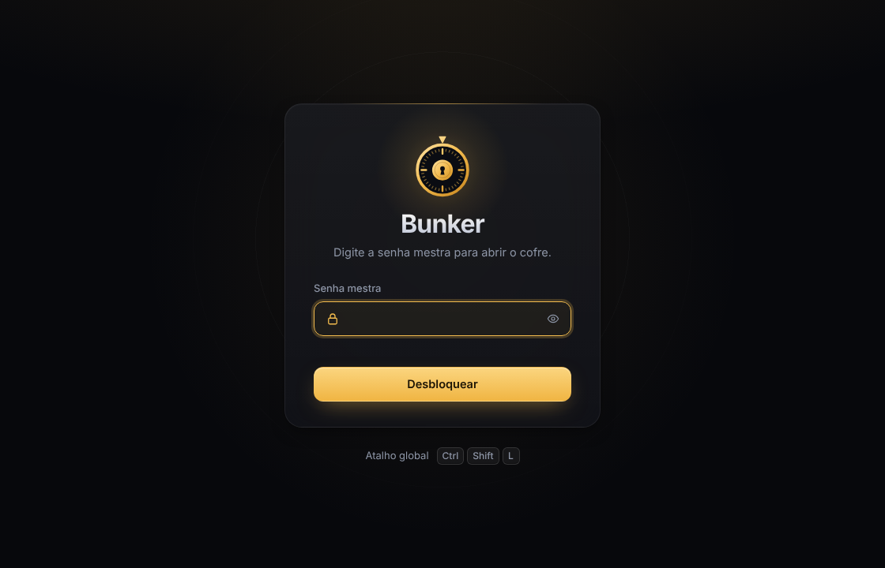
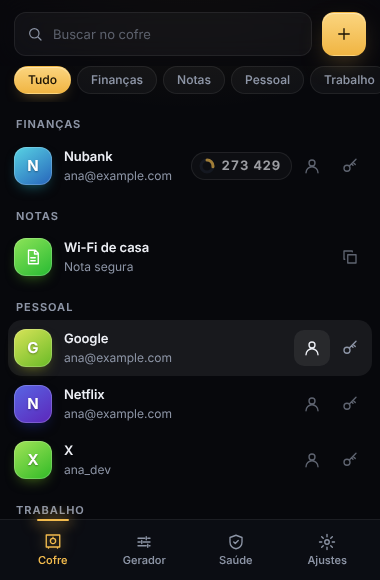
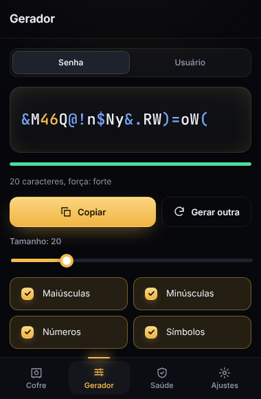
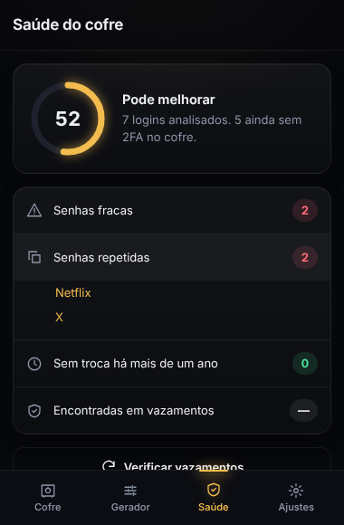
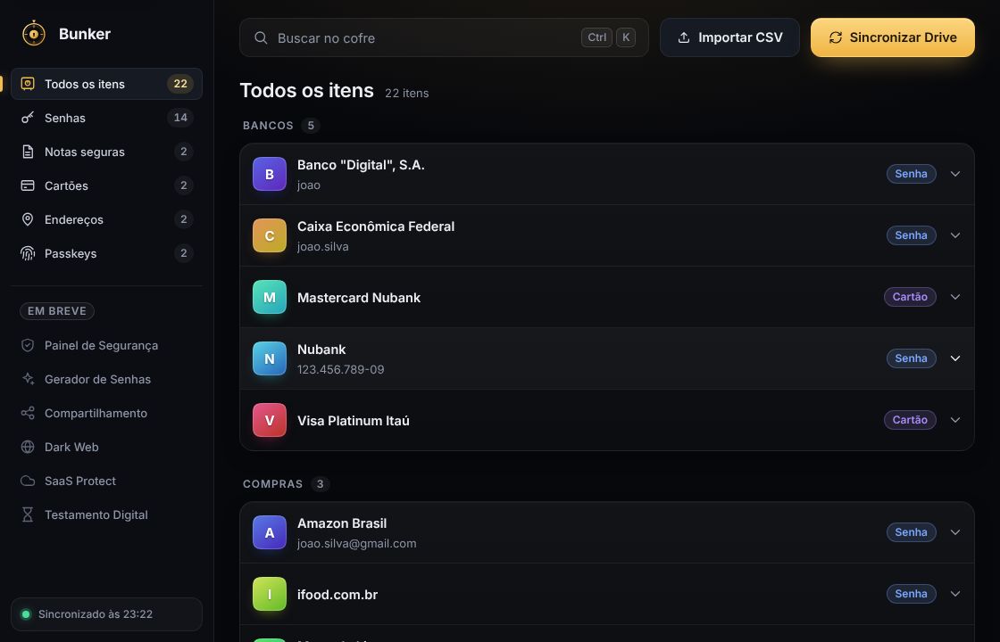
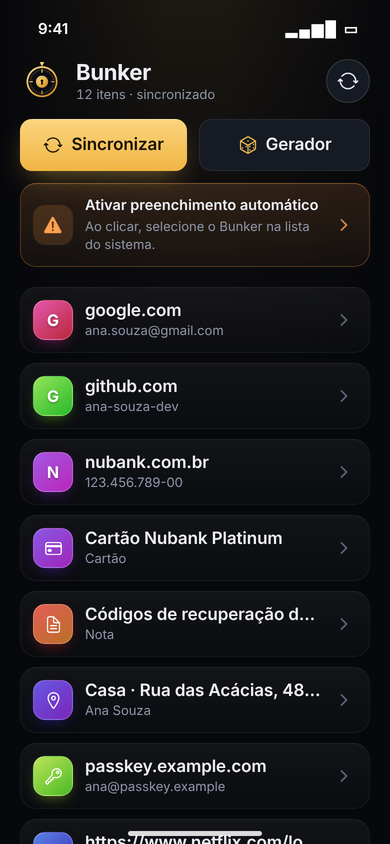
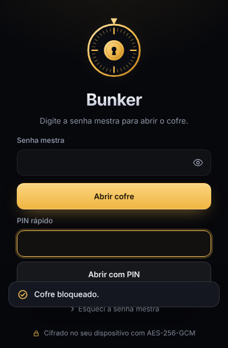
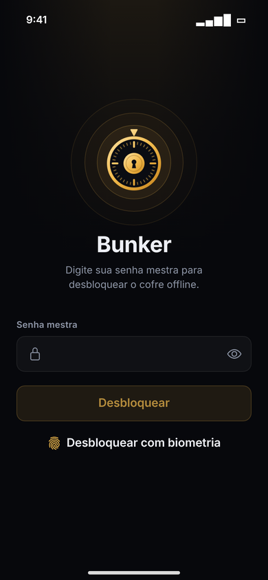
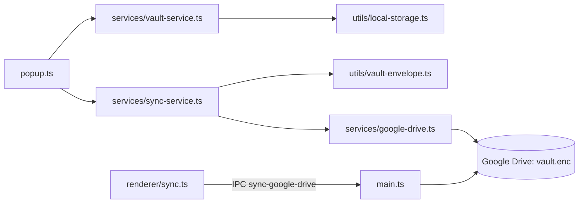

<div align="center">


# 🛡️ Bunker

**Gerenciador de senhas multiplataforma que sincroniza só o cofre cifrado com o seu Google Drive.**<br/>
A senha mestra nunca sai do dispositivo em texto puro; o cofre (`vault.enc`) é cifrado com AES-256-GCM antes de subir.

[](https://github.com/juninmd/bunker/releases)
[]()
[]()
[]()
[](https://github.com/juninmd/bunker/actions/workflows/validate.yml)

<br/>



</div>

> **Cofre de senhas no seu dispositivo, sincronizado pelo seu Drive.** Para começar: `cd apps/extension && npm ci && npm run build`, depois carregue a pasta `apps/extension` como extensão sem compactação no navegador.

## 💡 Por que o Bunker

Escopo deliberadamente pequeno: **guardar, preencher e gerar senhas, com sincronização pelo seu Google Drive**. Repositório monorepo, uma coleção de aplicativos localizados e documentação, com foco em privacidade e código de alta integridade.

- 🔒 **Privado.** Cofre cifrado com AES-256-GCM; a chave vem da senha mestra por PBKDF2-SHA256 com 600.000 iterações.
- 🔁 **Seu Drive.** Só o `vault.enc` cifrado sai do dispositivo; o `.csv` serve para importar e exportar manualmente.
- 🚚 **Migração.** Importa o CSV do LastPass mantendo pastas, notas seguras e códigos 2FA.

## 🖼️ Tour

<table>
<tr>
<td width="33%"><br/><b>Cofre</b> &ndash; busca e categorias.</td>
<td width="33%"><br/><b>Gerador</b> &ndash; tamanho e classes de caracteres.</td>
<td width="33%"><br/><b>Saúde</b> &ndash; senhas fracas, repetidas e sem 2FA.</td>
</tr>
</table>

<sub>Capturas da extensão, geradas pelo <code>npm run e2e</code> (<code>apps/extension/tests/e2e/homologation.mjs</code>).</sub>

## 📦 Instalação

### Extensão (Chrome e Edge)

```sh
cd apps/extension
npm ci            # dependências pelo package-lock.json
npm run build     # compila o TypeScript ao lado de src/, onde o manifest aponta
```

Em `chrome://extensions` (ou `edge://extensions`), ative o **Modo do desenvolvedor**, clique em **Carregar sem compactação** e escolha `apps/extension`.

Firefox: `npm run build:firefox` (não executado nesta revisão).

### Desktop (Electron)

```sh
cd apps/desktop
npm ci            # dependências pelo package-lock.json
npm start         # compila e abre o app (não executado nesta revisão: requer ambiente gráfico)
```

### Android (APK)

`npm run build:apk` em `apps/mobile` gera `dist/bunkerpass-mobile-1.0.0.apk` (não executado nesta revisão: requer Android SDK).

> [!NOTE]
> A sincronização com o Google Drive exige um OAuth Client ID próprio. Veja [docs/SETUP.md](docs/SETUP.md) e a seção Configuração.

## ⌨️ Uso

Os scripts de orquestração ficam em `scripts/bunker.sh`; sem argumentos ele mostra a ajuda:

```sh
bash scripts/bunker.sh
```

```text
Usage: scripts/bunker.sh {extension|desktop|android} [start|build]
```

No primeiro uso, crie a senha mestra (mínimo de 12 caracteres), adicione itens ou importe o CSV em **Ajustes**, e use **Sincronizar Drive** no desktop.

## ✨ Features

- **Isolated Applications**: Multiple apps stored within the `apps/` directory for clean separation.
- **Unified Documentation**: Centralized docs for all sub-projects.
- **Automation Scripts**: Comprehensive shell and python scripts for management and verification.
- **Release Automation**: Integrated with `release-please` para geração automatizada de tags e atualizações do `README.md`.
- **Sincronização com Google Drive**: apenas o cofre cifrado (`vault.enc`, AES-256-GCM) é enviado ao Drive; nenhuma senha sai do dispositivo em texto puro.
- **GitHub Actions Integration**: Automated generation of releases and tags, keeping the README.md updated via scripts.

## 🎨 Design

Interface escura e moderna, a "Bunker Midnight": fundo quase preto, acento dourado e um mostrador de cofre como marca. A mesma linguagem vale para a extensão, o desktop e o mobile (guia completo em [docs/DESIGN.md](docs/DESIGN.md)).

| Extensão | Desktop | Mobile |
| --- | --- | --- |
|  |  |  |
|  |  |  |

## 🛠️ DrivePass (Substituto do LastPass)

O DrivePass é um gerenciador de senhas multiplataforma, que sincroniza um cofre cifrado (`vault.enc`) no Google Drive. O `.csv` é só para importar/exportar manualmente (compatível com LastPass).

### 🔐 Modelo de segurança (extensão)
- Cofre local e remoto cifrados com AES-256-GCM; chave derivada da senha mestra via PBKDF2-SHA256 com 600.000 iterações (cofres antigos com 250.000 são migrados no próximo desbloqueio).
- Senha mestra de no mínimo 12 caracteres para criar um cofre novo.
- PIN de no mínimo 6 dígitos, apenas em memória (`chrome.storage.session`): some ao fechar o navegador e é apagado após 5 tentativas erradas.
- Páginas só veem os nomes de usuário do próprio site; a senha é preenchida após um clique real no ícone.
- Autofill usa o domínio informado pelo navegador (não pela página) e nunca devolve a senha salva ao verificar um login.
- ⚠️ Se você usou uma versão anterior que gravava `passwords.csv` no Drive, apague esse arquivo e a lixeira do Drive.
- A sessão aberta usa só a chave derivada em `chrome.storage.session`; ela some no bloqueio automático (15 min), ao bloquear o computador e ao fechar o navegador.
- Senhas copiadas saem da área de transferência após 30 s. Oferta de salvar login fica 60 s na memória do service worker e só grava após confirmação.

### 🚚 Migrar do LastPass
1. No LastPass: **Opções avançadas > Exportar > Arquivo CSV**.
2. No Bunker: **Ajustes > Importar CSV do LastPass** (mantém pastas, notas seguras e códigos 2FA). Apague o CSV depois.
3. Sincronização entre computadores: `node scripts/setup-drive-oauth.mjs` e [docs/SETUP.md](docs/SETUP.md).

### ✅ Homologação
`cd apps/extension && npm run build && npm test && npm run e2e` roda a extensão real no Chromium (criar cofre, importar CSV, 2FA, busca, gerador, saúde do cofre, autofill, salvar login, PIN, bloqueio automático, tema escuro por padrão e tema claro opcional) e grava os prints em [docs/screenshots](docs/screenshots). `npm run e2e:security` ataca a extensão como uma página hostil e um ladrão de disco; o relatório está em [docs/SECURITY.md](docs/SECURITY.md).
- Extensão (Firefox/Chrome)
- App Desktop (Electron - offline)
- Android APK (React Native / Expo, Android Autofill Framework, Sincronização Automática com Google Drive)
- Features de Paridade com o LastPass mapeadas no ROADMAP: Painel de Segurança, Passkeys, Login sem senha e SaaS Protect.

## 🔐 Segurança

| Camada | Proteção |
| --- | --- |
| Armazenamento | cofre local e remoto com AES-256-GCM; chave por PBKDF2-SHA256 (600.000 iterações) |
| Sessão | PIN apenas em memória (`chrome.storage.session`); bloqueio automático em 15 min |
| Rede | só o `vault.enc` cifrado vai ao Google Drive; páginas veem apenas o usuário do próprio site |

Modelo completo, homologação e como repeti-la em [docs/SECURITY.md](docs/SECURITY.md).

## 🧭 Como funciona



- Cifragem no cliente: o Drive recebe só o `vault.enc`, nunca a senha mestra nem a chave.
- Sincronização usa o mesmo envelope do cofre (`utils/vault-envelope.ts`) em ambos os sentidos.
- A sessão guarda só a chave derivada, em `chrome.storage.session`; ela some ao bloquear ou fechar o navegador.

## ⚙️ Configuração

| Variável | Propósito | Obrigatória / padrão | Exemplo |
| --- | --- | --- | --- |
| `GOOGLE_CLIENT_ID` | OAuth Client ID do Google Drive lido por `apps/desktop/src/main.ts` | opcional; sem ela usa o placeholder `YOUR_GOOGLE_CLIENT_ID.apps.googleusercontent.com` | `seu-client-id.apps.googleusercontent.com` |
| `BUNKER_MANIFEST` | manifest da extensão que `scripts/setup-drive-oauth.mjs` altera | opcional; `apps/extension/manifest.json` | `/caminho/para/manifest.json` |
| `BUNKER_KEY_PATH` | chave privada da extensão, fora do repositório | opcional; `~/.bunker/extension-key.pem` | `/caminho/para/extension-key.pem` |

## 🧪 Desenvolvimento

```sh
# Extensão
cd apps/extension
npm ci                 # dependências pelo package-lock.json
npm run build          # compila o TypeScript; os testes importam os .js gerados
npm test               # testes unitários (node tests/*.mjs); exige o build antes
npm run e2e            # Chromium real, grava prints em docs/screenshots (requer Chromium)
npm run e2e:security   # sonda de segurança da extensão (requer Chromium)

# Desktop
cd ../desktop
npm ci                 # dependências pelo package-lock.json
npm run build          # tsc + cópia de assets para dist/
npm start              # compila e abre o Electron

# Raiz
node scripts/setup-drive-oauth.mjs --client-id <id>.apps.googleusercontent.com   # fixa o ID da extensão e o client ID no manifest
```

## 🤝 Contribuição

Commits seguem Conventional Commits (`feat:`, `fix:`, `docs:`, `chore:`), como no histórico atual. As regras de desenvolvimento estão em [AGENTS.md](AGENTS.md).

## 📚 Documentação

| Documento | O que tem |
| --- | --- |
| 🛠️ <a href="docs/SETUP.md">Setup</a> | criar o projeto no Google Cloud e obter o OAuth Client ID |
| 🛡️ <a href="docs/SECURITY.md">Segurança</a> | homologação da extensão: escopo, data e como repetir |
| 🎨 <a href="docs/DESIGN.md">Design</a> | linguagem visual "Bunker Midnight" para extensão, desktop e mobile |
| 🗺️ <a href="docs/ROADMAP.md">Roadmap</a> | plano por fases rumo à paridade com o LastPass |
| 🖥️ <a href="apps/desktop/README.md">Desktop</a> · 📱 <a href="apps/mobile/README.md">Mobile</a> | README de cada app |

## 🚧 Limitações conhecidas

- **Passkeys**: suporte básico e UI presentes; fluxos WebAuthn nativos pendentes para a fase 3.
- **Google Drive**: exige OAuth Client ID próprio. No mobile o ID está fixo como placeholder em `apps/mobile/src/SyncService.ts`.
- **Autofill**: melhorias de Android e iOS ainda em andamento.
- **Capturas**: só as da extensão são regeneradas pelo `npm run e2e`; as de desktop e mobile não têm script de regeneração.

## 🛠️ Tech Stack

- **Structure**: Monorepo
- **Documentation**: Markdown-driven
- **Automation**: Bash + Python
- **Release**: GitHub Actions + Release Please

## 🛡️ Antigravity Protocol

This project follows the **Antigravity** code standards:
- **Modular Apps**: Each application in `apps/` is strictly isolated.
- **150-Line Limit**: Applied to all management scripts in the `scripts/` directory.
- **Strict Verification**: Every change must pass the `verification/` suite.

## 🔄 Current Progress & Next Steps (CRON Loop)

**Progress**:
- Início da **Fase 3**: Aprimoramentos Contínuos e Refinamentos.
- Implementação de Otimizações de Sincronização em Segundo Plano no Mobile usando `expo-task-manager` e `expo-background-fetch`. O cofre agora continua sendo atualizado de forma silenciosa.

**Known Bugs**:
- Nenhum bug funcional conhecido. Os testes estão passando em todos os apps integrados.

**Next Tasks**:
- Manutenção de dependências e monitoramento de saúde do código.

## ⚖️ Licença

Não definida no repositório: o `package.json` da raiz declara `ISC`, não há arquivo `LICENSE` e a API do GitHub retorna `license: null`. Pendente de decisão do autor.

---

*"Security is not a feature; it is the foundation."*
